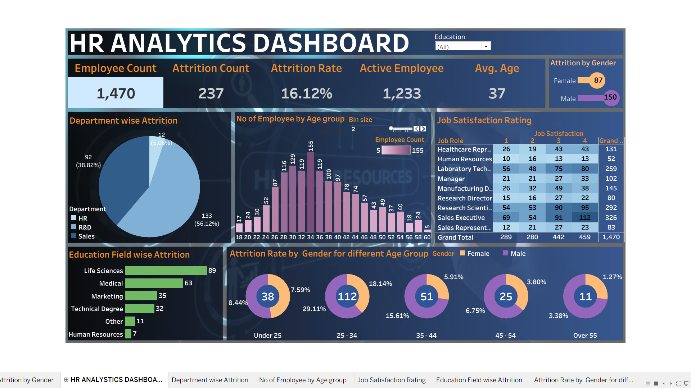

# HR Analytics Dashboard using Tableau

## Project Overview
This project analyzes employee data to understand employee attrition,
demographics, and job satisfaction using Tableau.

## Tools Used
- Tableau
- Data Visualization
- Data Analysis

## Key Performance Indicators
- Total Employees: 1,470
- Attrition Count: 237
- Attrition Rate: 16.12%
- Active Employees: 1,233
- Average Employee Age: 37

## Dashboard Insights
- Department-wise Attrition
- Attrition by Gender
- Employee Distribution by Age Group
- Job Satisfaction by Job Role
- Education Field-wise Attrition

## Project Files
- Tableau workbook (.twbx)
- Dashboard screenshot (.png)
## Dashboard Preview

